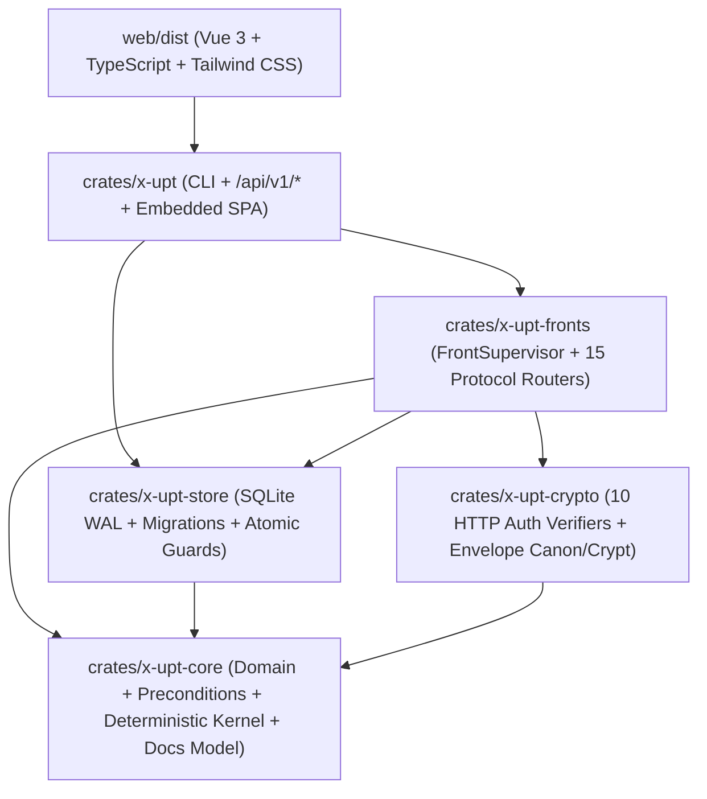

# `x-upt` 系统架构、存储与运维技术规范（Technical Specification）

本规范定义 `x-upt` 的 Cargo Workspace 模块边界、CLI 参数与环境变量、`SQLite` 存储结构、`FrontSupervisor` 动态端口热启停生命周期、31 列结构化 `access_log` 脱敏规则以及本地与容器化运维方式。上游协议调用细则见 [API.md](./API.md)，信封画像与密码学规范见 [ENVELOPE.md](./ENVELOPE.md)，工程红线见 [IRON_RULES.md](../IRON_RULES.md)。

---

## 1. 架构分层与物理端口隔离

`x-upt` 编译为内嵌 WebUI 静态资源的单二进制可执行文件，内部遵循严格的单向依赖分层：



| 模块路径 | 职责边界 |
|---|---|
| `crates/x-upt-core` | 领域模型、开关前置门控纯函数、`posts.search` / `photos.render` / `imgdef.compare` 确定性内存计算核、同源文档与 OpenAPI 生成器、31 列日志模型及统一错误类型 `AppError`（零网络、数据库、静态嵌入依赖） |
| `crates/x-upt-crypto` | 10 种 HTTP 鉴权校验器、表单 `HMAC-SHA256` 双向签名、信封 3 种规范化拼串（`canon`）、闭集签名/加解密/密钥封装原语（`crypt`）及密钥格式校验 |
| `crates/x-upt-store` | 基于 bundled `rusqlite`（开启 `WAL` 与 `FOREIGN KEY`）管理 `<data-dir>/x-upt.db`，执行只追加幂等迁移，在数据库事务内原子完成素材增删与开关前置校验 |
| `crates/x-upt-fronts` | 实现 `FrontSupervisor`，动态热绑定/释放 15 个模拟接入面的 `TcpListener`，按面物理隔离内存令牌桶、Nonce 防重放表与异步 `JobStore`，基于 `ArcSwap` 只读快照实现零锁竞争高频派发 |
| `crates/x-upt` | 主二进制入口：解析 CLI 与环境变量，监听管理控制台端口，挂载 `/health`、`/api/v1/*`（契约定义见 [admin-openapi.json](../crates/x-upt/admin-openapi.json)）与 `rust-embed` 静态前端 |
| `web/` | 离线自包含前端工作台（零外部 CDN），生产产物 `web/dist` 在编译期嵌入主二进制 |

### 1.1 控制面与模拟业务面物理隔离规则

1. **端口严格分离**：管理控制台与 `/api/v1/*` 仅绑定 `--admin-listen` 指定的管理端口（默认 `0.0.0.0:18768`），绝不挂载到任何模拟上游端口（`16000`–`16008`、`16010`–`16015`），避免污染上游协议路由、鉴权挑战头与 `access_log`。
2. **404 防穿透与双轨缓存头**：
   - 管理端口上 `/health` 与 `/api/*` 未命中的路径固定返回 `404` JSON（`Content-Type: application/json`），禁止回退返回 `index.html`；
   - 缺失的 `/assets/*` 或带文件扩展名的静态资源路径返回真实 `404`；
   - 前端路由入口 `index.html` 返回 `Cache-Control: no-cache`、内容哈希 `ETag`（支持 `If-None-Match` 协商返回 `304`）与 `X-Content-Type-Options: nosniff`；
   - 带内容指纹的 `/assets/*` 资源返回 `Cache-Control: public, max-age=31536000, immutable` 与 `X-Content-Type-Options: nosniff`。

---

## 2. CLI 子命令、参数与环境变量

### 2.1 子命令

```bash
# 启动管理控制台与模拟上游监管服务
x-upt serve [--admin-listen 0.0.0.0:18768] [--data-dir ./data] [--admin-token <TOKEN>]

# 离线执行数据目录迁移与已启用开关前置条件自检（校验通过以退出码 0 结束）
x-upt check [--data-dir ./data]

# 输出二进制版本与构建信息
x-upt version
```

### 2.2 参数与环境变量映射

| CLI 参数 | 对应环境变量 | 默认值 | 说明 |
|---|---|---|---|
| `--admin-listen <ADDR>` | `X_UPT_ADMIN_LISTEN` | `0.0.0.0:18768` | WebUI 与 `/api/v1/*` 管理控制台监听地址 |
| `--data-dir <PATH>` | `X_UPT_DATA_DIR` | 本地 `./data`，容器内 `/data` | 运行数据根目录（存放 `x-upt.db`、导入图片与访问日志） |
| `--admin-token <TOKEN>` | `X_UPT_ADMIN_TOKEN` | 未设置（免登录直连） | 可选管理口令；设置后访问 `/api/v1/*` 须携带 `Authorization: Bearer <TOKEN>` 或通过 `/api/v1/auth/login` 建立受控会话 Cookie |

> [!IMPORTANT]
> 管理控制台始终启用 `origin_and_host_guard` 中间件，校验 `Host` 头合法性以及状态修改请求的同源 `Origin` / `Referer`，阻断跨站请求伪造与 DNS 重绑定访问。

---

## 3. 运行数据目录与 `SQLite` 存储模型（`x-upt.db`）

### 3.1 `<data-dir>` 目录结构

```text
<data-dir>/
├── x-upt.db              # SQLite 主数据库文件（WAL 模式，外键强约束）
├── x-upt.db-wal          # SQLite Write-Ahead Log
├── x-upt.db-shm          # SQLite 共享内存索引
├── images/               # 通过 WebUI 或 API 导入的基准图片原文件
└── logs/
    ├── x-upt.log         # 31 列 JSON Lines 结构化上游访问流水日志
    └── x-upt.console.log # scripts/run.sh 守护模式下的标准输出日志
```

### 3.2 `x-upt.db` 核心数据表

表结构变更严格通过递增版本的只追加幂等迁移脚本（`IF NOT EXISTS`）演进：

| 表名 | 主键 | 核心持久化字段与默认值 |
|---|---|---|
| `schema_migrations` | `version` | 已应用的递增迁移版本号与执行时间戳 |
| `global_settings` | 单行配置 | `latency_min_ms`（默认 20 毫秒）、`latency_max_ms`（默认 100 毫秒）、`token_expire_minutes`（默认 30 分钟）、`token_cleanup_seconds`（默认 300 秒）、`token_max_per_client`（默认 `0` 不限）、`sign_window_seconds`（默认 300 秒）、`sign_nonce_ttl_seconds`（默认 600 秒）、`job_expire_seconds`（默认 600 秒） |
| `business_methods` | `method` | `x_upt.posts.search`、`x_upt.photos.render`、`x_upt.imgdef.compare` 三行开关状态，初始 `enabled = 0` |
| `fronts` | `name` | 15 个接入面的 `enabled`（初始 `0`）、`host`（默认 `0.0.0.0`）、`port`（默认建议端口 `16000`–`16008` 与 `16010`–`16015`）、`http2`、`h2c`（仅 `grpc` 默认 `true`）、`expire_minutes`（默认 30 分钟）、`auth_methods_json`、TLS 证书链/私钥/客户端根证书 PEM（`cert_pem`、`key_pem`、`client_ca_pem`）、`ws_max_conn`（默认 1024）、`ws_ping_secs`（默认 30 秒）、`job_workers`（默认 4） |
| `images` | `id` | 导入图片唯一 ID、安全单层 `filename`、所属场景 `scene`（`article_cover` \| `avatar` \| `banner`）、`mime`、`width`、`height`、`size`、导入时预计算的 64 位感知哈希 `ahash_u64`、`<data-dir>/images/` 下的存储文件名与创建时间 |
| `posts` | `id` | 帖子 `id`（`u64`）、作者 `user_id`（`u64`）、`title`、`body` |
| `apps` | `client_id` | `client_id`（`1`–`64` 字符）、`client_secret`（`8`–`128` 字节）、显示名 `name`、可选 JWT 非对称验签公钥 `rsa_public_pem`、授权方法数组 `methods_json`、`created_at` |
| `envelope_secrets` | `name` | 信封密钥唯一名 `name`、类型 `kind`（`text` \| `bytes_hex` \| `pem`）、原始密钥字节、SHA-256 短指纹 `fingerprint`、可安全回显的公开公钥 `public_material`、`updated_at` |
| `envelope_profiles` | `(front, name)` | 所属信封面 `front`、排序序号、完整画像配置 JSON（对应 `EnvelopeProfileSpec`） |

---

## 4. `FrontSupervisor` 动态生命周期与无锁快照

### 4.1 启停状态机

1. **冷启动恢复**：`x-upt serve` 启动时首先绑定管理控制台端口，随后扫描 `x-upt.db` 中 `enabled = 1` 的接入面记录；全新空库下开启面数量为 `0`，不绑定任何模拟上游端口；非空库重启时自动重校验前置条件并恢复绑定先前处于开启状态的全部接入面。
2. **热开启（Hot Bind）**：管理端收到 `POST /api/v1/fronts/{front}/enable` 后，先在 `SQLite` 事务内完成端口冲突、TLS 证书、业务子接口与凭据/信封密钥完整性校验；通过后执行 `TcpListener::bind(host:port)`，为该面分配物理隔离的内存状态（`TokenManager` 或 `EnvelopeTokenStore`、`NonceStore`、`JobStore`）与独立子 `CancellationToken`，拉起协议监听协程并提交 `enabled = 1`。
3. **热关闭（Hot Unbind）**：收到 `POST /api/v1/fronts/{front}/disable` 后，更新 `enabled = 0` 并立即取消该接入面的子 `CancellationToken`，优雅排空活跃请求、立即释放 TCP 端口并回收该面专属的内存动态令牌桶与任务表，主进程及其他运行中接入面零中断。
4. **快照热刷新（Lock-Free Read Path）**：每次导入或删除图片、增删改帖子、变更应用凭据、调整全局延迟或切换业务子接口开关时，存储层从 `SQLite` 构建新的不可变快照并通过 `ArcSwap` 原子替换；上游协议协程处理请求时仅读取内存引用，全程无数据库读锁、严禁跨 `.await` 持互斥锁。
5. **全进程优雅停机**：主进程捕获 `SIGINT` 或 `SIGTERM` 信号后触发根 `CancellationToken`，并发通知控制台端口、所有已启用的模拟接入面与后台清理/任务协程停机，在 10 秒内释放全部监听套接字、刷盘 `SQLite` WAL 并以状态码 `0` 退出。

---

## 5. 管理控制台 API 速查（`/api/v1/*`）

完整 OpenAPI 3.0.3 路由契约见 [admin-openapi.json](../crates/x-upt/admin-openapi.json)（由 `scripts/check_routes.py` 双向校验一致性）：

| 功能分组 | 方法与路径 | 说明 |
|---|---|---|
| 健康与会话 | `GET /health`、`GET /api/v1/auth/session`、`POST /api/v1/auth/login`、`POST /api/v1/auth/logout` | 服务探活与可选 `--admin-token` 会话登录/登出 |
| 状态与全局参数 | `GET /api/v1/status`、`GET /api/v1/settings`、`PUT /api/v1/settings` | 汇总 3 个子接口与 15 个接入面的开启状态、`can_enable`、`missing_preconditions`、素材计数及全局延迟/TTL 参数 |
| 业务子接口开关 | `POST /api/v1/methods/{method}/enable`、`POST /api/v1/methods/{method}/disable` | 前置门控开启或关闭 `x_upt.posts.search`、`x_upt.photos.render`、`x_upt.imgdef.compare`（冲突返回 `409`） |
| 接入面配置与开关 | `GET /api/v1/fronts`、`PUT /api/v1/fronts/{front}`、`POST /api/v1/fronts/{front}/enable`、`POST /api/v1/fronts/{front}/disable` | 修改接入面 `host:port`、TLS PEM、允许鉴权列表及热绑定/热卸载端口 |
| 基准图片库 | `GET /api/v1/images`、`POST /api/v1/images`、`GET /api/v1/images/{id}/raw`、`DELETE /api/v1/images/{id}` | 上传 PNG/JPEG/GIF 场景图片（自动校验尺寸与计算 64 位 `aHash`）、原图预览与受门控保护的删除 |
| 帖子数据集 | `GET /api/v1/posts`、`POST /api/v1/posts`、`POST /api/v1/posts/import`、`PUT /api/v1/posts/{id}`、`DELETE /api/v1/posts/{id}` | 单条维护或 JSON 数组批量导入帖子记录 |
| 应用凭据 | `GET /api/v1/apps`、`POST /api/v1/apps`、`PUT /api/v1/apps/{client_id}`、`DELETE /api/v1/apps/{client_id}` | 管理核心接入面调用方凭据、RSA 公钥与方法授权（列表接口脱敏 `client_secret`） |
| 信封密钥与画像 | `GET/POST /api/v1/envelopes/secrets`、`DELETE /api/v1/envelopes/secrets/{name}`、`GET/PUT /api/v1/envelopes/{front}/profiles` | 上传或生成合规信封密钥（仅回显指纹与公钥）并配置 6 个信封面画像 |
| 在线文档与契约 | `GET /api/v1/docs/fronts`、`GET /api/v1/contracts/{name}` | 获取实时端口在线调用文档，下载 `grpc.proto`、`grpc.fds`、`soap.wsdl`、`graphql.sdl`、`upstream-openapi.json` |
| 日志与任务队列 | `GET /api/v1/logs/recent`、`GET /api/v1/jobs` | 查询内存环形缓冲中最近的脱敏 `access_log` 记录与 `job` 面任务状态 |

---

## 6. 31 列结构化 `access_log` 与脱敏规范

15 个模拟上游接入面产生的每一笔请求与异步任务终态均以单行 JSON（JSON Lines）写入 `<data-dir>/logs/x-upt.log` 与内存最近日志环形缓冲，严格固定包含以下 31 个字段：

### 6.1 31 列字段定义表

| 序号 | 字段名 | JSON 类型 | 字段含义与取值规则 |
|---|---|---|---|
| 1 | `request_id` | `string` | 透传的合法 `X-Request-Id`（或 gRPC `x-request-id`、WS 帧 `id`）或自动生成的 `UUIDv4` |
| 2 | `ts` | `string` | RFC 3339 UTC 时间戳 |
| 3 | `level` | `string` | 日志级别：`status >= 500` 为 `"error"`，`status >= 400` 或 `error` 非空为 `"warn"`，其余为 `"info"` |
| 4 | `event` | `string` | 事件分类：`access`（真实入站请求）\| `job_done`（异步任务执行结束）\| `job_expired`（异步任务超时过期） |
| 5 | `method` | `string` | 协议动词（如 `"POST"`、`"GET"`、`"HEAD"`、`"WS"`） |
| 6 | `path` | `string` | 请求路径（如 `"/posts/search"`、`"/x_upt.v1.XUpt/SearchPosts"`、`"/ws"`） |
| 7 | `query` | `string \| null` | 经敏感键脱敏后的 URL 查询字符串（无查询参数时为 `null`） |
| 8 | `status` | `u16` | HTTP 状态码或协议映射状态码 |
| 9 | `code` | `number \| string \| null` | 协议业务码（网关数值码、REST 短码、JSON-RPC 整数码、`sign_gateway` 的 `10000`/`sub_code`、SOAP `faultcode`） |
| 10 | `duration` | `u64` | 请求总耗时（单位：毫秒） |
| 11 | `duration_auth` | `u64 \| null` | 鉴权校验耗时（单位：毫秒） |
| 12 | `duration_core` | `u64 \| null` | 核心业务计算耗时（单位：毫秒） |
| 13 | `duration_latency` | `u64 \| null` | 模拟人工延迟休眠耗时（单位：毫秒） |
| 14 | `ip` | `string \| null` | 客户端来源 IP |
| 15 | `client_id` | `string \| null` | 通过鉴权或请求参数识别出的调用方 `client_id` |
| 16 | `bytes_in` | `u64 \| null` | 入站载荷字节数 |
| 17 | `bytes_out` | `u64 \| null` | 出站响应载荷字节数 |
| 18 | `error` | `string \| null` | 失败摘要描述（成功时为 `null`） |
| 19 | `error_kind` | `string \| null` | 机器可读错误分类（如 `"unauthorized"`、`"unprocessable"`、`"not_found"`） |
| 20 | `in` | `object \| value` | 剥离图片 Base64 与敏感口令后的入站业务参数 |
| 21 | `out` | `object \| value` | 剥离图片 Base64 与令牌明文后的出站业务摘要 |
| 22 | `front` | `string` | 接入面 `snake_case` 名称（如 `"rest"`、`"envelope_sign_crypt"`） |
| 23 | `port` | `u16` | 接收该请求的模拟接入面监听端口号 |
| 24 | `rpc` | `string \| null` | 调用的业务方法线名称（如 `"x_upt.posts.search"`） |
| 25 | `job_id` | `string \| null` | `job` 接入面提交或轮询的任务 UUID |
| 26 | `user_agent` | `string \| null` | 请求头 `User-Agent` |
| 27 | `referer` | `string \| null` | 请求头 `Referer` |
| 28 | `content_type` | `string \| null` | 请求头 `Content-Type` |
| 29 | `auth` | `string \| null` | 实际通过或推断的鉴权方式标识（如 `"api_key"`、`"jwt"`、`"hmac"`、`"envelope_sign"`） |
| 30 | `pid` | `u32` | 当前 `x-upt` 操作系统进程号 |
| 31 | `host` | `string \| null` | 主机名或请求 `Host` 标识 |

> [!NOTE]
> `job_done` 与 `job_expired` 行属于异步任务后台生命周期记录，复用提交该任务时的 `request_id`、`ip` 与客户端元数据；统计真实入站请求量（RPS/吞吐）时仅筛选 `event == "access"`。

### 6.2 密钥与图片 Base64 强制脱敏规则

1. **URL `query` 脱敏**：查询参数键名（转 ASCII 小写后）属于以下集合时，日志中对应值统一脱敏记为 `***`：`api_key`、`x-api-key`、`access_token`、`authorization`、`secret`、`client_secret`、`image`、`clientid`、`clientsecret`、`password`、`passwd`、`sign`、`params`、`encryptstr`、`appcode`、`corpsecret`、`accesstoken`、`token`、`company_id`。
2. **`in` 与 `out` 图片 Base64 剥离**：写入日志前递归遍历 `in` 与 `out` JSON，移除所有字符串类型的 `"image"` 字段（比图入参）与 `"base64"` 字段（渲染出参），仅保留 `filename`、`mime`、`size`、`matched`、`distance` 等轻量元数据；GraphQL 请求 `in.query` 中内联的 `image: "..."` 字符串字面量自动重写为空串 `image: ""`（真实网络响应体仍完整返回 Base64 内容）。
3. **换票响应脱敏**：核心面 `oauth_cc` / `gettoken` 在日志 `out` 中仅记录 `expires_in` 等元数据，不落盘签发的 `access_token` 明文。

---

## 7. 本地脚本与容器化部署

### 7.1 宿主机守护脚本（[run.sh](../scripts/run.sh)）

编译生成 `x-upt` 二进制（位于项目根目录、`target/release/x-upt` 或 `target/debug/x-upt`）后，可通过 [run.sh](../scripts/run.sh) 管理后台进程（PID 文件位于 `<project_root>/x-upt.pid`）：

```bash
# 启动服务（支持通过环境变量覆盖监听地址、数据目录与可选管理口令）
X_UPT_ADMIN_LISTEN=0.0.0.0:18768 X_UPT_DATA_DIR=./data ./scripts/run.sh start

# 查看运行状态 / 平滑重启 / 发送 SIGTERM 优雅停止
./scripts/run.sh status
./scripts/run.sh restart
./scripts/run.sh stop
```

### 7.2 Docker 与 Compose 持久化部署

多阶段构建定义见根 [Dockerfile](../Dockerfile)：前端构建阶段生成离线 `web/dist`，Rust 构建阶段按 `rust-toolchain.toml` 编译 `--release --locked` 单二进制 `x-upt`，运行阶段使用非特权用户 `xupt`（UID/GID `10001:10001`）与 `tini` 守护进程，默认数据卷挂载于 `/data`，容器健康检查探测管理端 `/health`。

```bash
# 使用自包含 Compose 编排启动并持久化 /data 数据卷
docker compose -f deploy/compose.yml up -d --build

# 单容器直接运行示例
docker run -d --name x-upt \
  -p 18768:18768 \
  -p 16000-16008:16000-16008 \
  -p 16010-16015:16010-16015 \
  -v x-upt-data:/data \
  -e X_UPT_DATA_DIR=/data \
  x-upt:latest
```

---

## 8. 注意事项

- 模拟上游服务不发起任何出站网络请求或异步 Webhook 回调。
- 备份或迁移环境时，在服务停止状态下归档整个 `<data-dir>` 目录（含 `x-upt.db` 与 `images/` 子目录）可完整保留全部图片素材、帖子数据、凭据密钥与接口开关状态。
